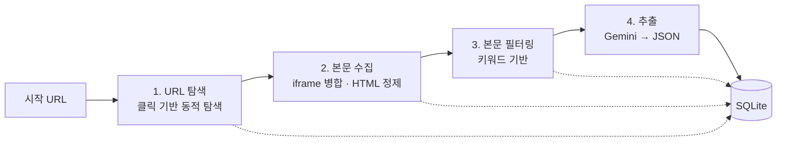

# my_scrapper: 클릭 기반 동적 웹 크롤러

> 사람처럼 화면의 버튼과 메뉴를 **하나씩 눌러 보며** 사이트를 탐색하는 범용 크롤러.
> 팀 캡스톤 프로젝트에 적용해, 학교 공지에서 **LLM으로 일정을 추출하는 파이프라인**으로 확장했습니다.

개인 프로젝트 (팀 캡스톤 프로젝트에 적용) | 2026.06 ~ 진행중

<br>

## 만든 이유

요즘 웹사이트는 탭 메뉴, JavaScript 버튼, iframe 안의 게시판처럼 **링크(`href`)만 따라가서는 도달할 수 없는 페이지**가 많습니다. 링크를 모으는 일반적인 크롤러로는 이런 페이지를 빠짐없이 찾기 어렵습니다.

그래서 특정 사이트에 맞춘 규칙 없이, **시작 주소만 주면 화면에 보이는 요소를 직접 클릭하며 페이지를 찾아내는 범용 크롤러**를 만들었습니다.

<br>

## 팀 프로젝트 적용: 학교 공지 일정 추출

이 크롤러를 팀 캡스톤 프로젝트인 [일정 비서](https://github.com/yoonseo0832/capstone-project)(LMS 과제·공지를 모아 텔레그램으로 알려 주는 서비스)에 적용했습니다.

학교 공지는 학과, 단과대, 학생지원 부서 등 **여러 사이트와 게시판에 흩어져** 있어 중요한 일정을 놓치기 쉽습니다. 크롤러로 각 사이트를 탐색한 뒤, 공지를 골라 LLM으로 일정을 추출하는 파이프라인(아래 2~4단계)을 크롤러 위에 추가했습니다.

| 담당 | 내용 |
|---|---|
| 본인 | 크롤러, 본문 수집·필터링·LLM 일정 추출 파이프라인, 추출한 일정을 팀 공용 DB로 옮기는 연동 코드 |
| 팀원 | Canvas LMS 과제·공지 수집, 공유 일정 DB, Gemini 답변 비서, 텔레그램 봇 |

크롤러 코드는 팀 저장소에 `git subtree`로 포함해, 양쪽에서 수정한 내용을 주고받습니다.

<br>

## 파이프라인

1단계(URL 탐색)가 범용 크롤러이고, 2~4단계는 크롤링된 본문에서 원하는 내용을 추출하기 위해, 그 위에 붙인 파이프라인입니다.



| 단계 | 하는 일 | 저장 테이블 |
|---|---|---|
| 1. URL 탐색 `crawl()` | 시작 URL에서 클릭 가능한 요소를 하나씩 눌러 새 페이지를 찾음 | `url` |
| 2. 본문 수집 `fetch_contents()` | 아직 방문하지 않은 URL만 열어 본문을 수집하고 정제 | `raw_content` |
| 3. 필터링 `filter_urls()` | 키워드로 공지 필요한 내용이 포함된 페이지만 선별 | `filtered_url` |
| 4. 일정 추출 `extract_schedules()` | LLM으로 원하는 내용을 JSON으로 추출 | `extracted_schedules` |

각 단계는 **독립적으로 실행**할 수 있고 이미 처리한 항목은 건너뛰기 때문에, 중간에 멈춰도 그 지점부터 이어서 작업할 수 있습니다. LLM 추출도 아직 추출하지 않은 본문만 골라 추출해 API 비용을 아낍니다.

<br>

## 핵심 구현

### 1. 클릭 기반 동적 탐색

링크 주소를 모으는 대신, 화면의 요소를 실제로 클릭해 보고 **무엇이 바뀌었는지**로 다음 행동을 정합니다.

- **클릭 후보 추출**: `a`, `button`, `li`, `span` 등에서 텍스트가 있거나 상호작용 가능한 요소를 고르고, 로그아웃·회원탈퇴·언어 변경처럼 누르면 안 되는 요소는 키워드로 제외합니다.
- **변화 판별**: 클릭 후 결과를 세 가지로 구분합니다.
  - **페이지 이동** → 새 URL로 수집하고 탐색 대기열에 추가
  - **iframe 변화** → 같은 페이지의 새 상태로 기록
  - **요소 변화** (탭 전환, 드롭다운 펼침 등) → 새로 나타난 요소만 클릭 후보에 추가
- **탐색 순서**: 한 페이지 안의 클릭은 깊이 우선(스택), 새로 발견한 페이지는 너비 우선(큐)으로 탐색하고, 최대 깊이를 넘으면 되돌아갑니다. 같은 페이지에서 이미 본 요소는 다시 후보에 넣지 않습니다.

### 2. 화면 안정화 감지

동적 페이지는 로드 직후에도 화면이 계속 바뀝니다. 처음에는 페이지 로드 시점의 요소를 기준으로 탐색했는데, **탐색이 중간에 멈추거나 화면의 요소를 모두 탐색하지 못하는** 문제가 있었습니다.

원인을 하나씩 확인해 보니 다음과 같은 경우가 있었습니다.
- 로딩 표시처럼 **잠깐 나타났다가 사라지는 요소**를 후보로 잡았다가, 클릭할 때는 이미 없어져 오류 발생
- 스크립트가 실행된 뒤 **늦게 나타나거나 활성화되는 요소**를 놓침

그래서 "로드가 끝난 시점"이 아니라 **"화면이 더 이상 바뀌지 않는 시점"**을 기준으로 삼도록 바꿨습니다.

```
0.1초 간격으로 요소 목록을 다시 읽음
  └ 이전 목록과 비교(difflib)
      ├ 사라진 요소 → "사라짐" 표시 (다시 나타나도 불안정한 요소로 보고 제외)
      ├ 새로 생긴 요소 → 추가
      └ 변화 없음이 1초 지속 → 안정화 완료 (최대 5초 대기)
안정화된 요소 중 실제로 클릭 가능한지 시험 클릭(trial)으로 한 번 더 확인
```

같은 방식을 **iframe 목록**에도 적용해, 늦게 붙거나 잠깐 생겼다 사라지는 프레임도 걸러냈습니다.

### 3. 명령 재생으로 이전 상태로 되돌리기

탐색하다 보면 이전 화면으로 돌아가야 하지만, 브라우저의 화면 상태(펼친 메뉴, 선택한 탭 등)는 저장해 둘 수 없습니다.
그래서 **페이지 주소와 그 안에서 실행한 클릭 기록**을 저장해 두고, 되돌릴 때는 주소로 다시 이동한 뒤 기록된 클릭을 순서대로 재생해 같은 상태를 만듭니다.

재생 중 클릭이 실패하면(사이트 내용이 바뀐 경우 등) 실패한 지점까지만 복원하고, 그 이후 구간의 탐색 후보는 스택에서 함께 버려 잘못된 상태에서 탐색이 이어지지 않도록 했습니다.

### 4. iframe 처리

- 프레임마다 클릭 후보를 따로 관리하고, 주소가 겹쳐 구분할 수 없는 프레임은 제외합니다.
- 본문을 수집할 때는 각 `<iframe>` 안에 그 프레임의 실제 내용을 **재귀적으로 병합**해, 게시판이 iframe 안에 있어도 본문이 누락되지 않게 했습니다.

### 5. 본문 정제와 LLM 일정 추출

- **정제**: `script`, `style`, 헤더·푸터, 폼 요소 등을 지우고 `href` 외의 속성, 빈 태그, 불필요한 공백을 제거해 LLM에 넘길 텍스트를 줄였습니다.
- **추출**: Gemini API에 JSON 응답 형식을 지정하고(`response_mime_type: application/json`, `temperature: 0.1`), 아래 형식으로 받습니다. (값은 형식을 보여 주기 위한 예시)
  ```json
  [{
    "title": "2학기 SW 해커톤 참가자 모집",
    "has_schedule": true,
    "start_date": "2026-11-01",
    "end_date": "2026-11-15T18:00:00",
    "summary": "SW 해커톤 참가팀을 모집하며 온라인으로 신청할 수 있습니다.",
    "target": "학부생",
    "action_items": ["온라인 신청서 제출"]
  }]
  ```
- **프롬프트 설계**: 게시판 **목록 페이지**에서는 일정을 뽑지 않도록 하고(여러 글의 날짜가 섞여 잘못된 일정이 생기므로), 한 공지에 일정이 여러 개면 각각 나눠 추출하도록 지시했습니다.
- API 키 없이도 개발할 수 있도록 규칙 기반 `MockContentExtractor`를 두었습니다.

### 6. 교체 가능한 구조

저장소(`UrlStorage`, `ContentStorage`), 공급자(`UrlsProvider`), 필터(`ContentFilter`), 추출기(`ContentExtractor`)를 인터페이스로 분리했습니다. 메모리 저장소와 DB(SQLAlchemy) 저장소, Gemini와 Mock 추출기를 코드 수정 없이 바꿔 끼울 수 있습니다.

<br>

## 실행 모습

<!-- 실제 실행 모습 -->
추가예정...

<br>

## 사용 예시

```python
import asyncio
from my_scrapper import WebScrapper

async def main():
    scrapper = WebScrapper(
        db_path="scrapper.db",
        max_depth=1,              # URL 탐색 깊이
        # api_key="..."           # 생략 시 GEMINI_API_KEY 환경 변수, 없으면 Mock 사용
    )
    scrapper.add_source("https://example.ac.kr/notice", "학과 공지")

    await scrapper.run()          # 1~4단계 일괄 실행 (단계별 실행도 가능)

    for s in scrapper.get_schedules():
        print(s.start_date, s.end_date, s.summary)
    scrapper.close()

asyncio.run(main())
```

```bash
pip install -r requirements.txt
playwright install chromium
```

- Python 3.12 이상이 필요합니다.
- 저장소 폴더(`my_scrapper`)의 상위 폴더에서 패키지로 import해 사용합니다.

<br>

## 프로젝트 구조

```
my_scrapper/
├── scrapper.py              # 4단계 파이프라인을 묶은 WebScrapper
├── core/
│   ├── session.py           # 브라우저 세션, 페이지 상태 기록·복원, iframe 안정화
│   ├── locator.py           # 클릭 후보 추출, 요소 안정화 감지
│   └── commands.py          # Click / Fill 명령 (재생 가능한 단위)
├── crawler/
│   ├── click_explorer.py    # 클릭 기반 탐색 (스택 + 되돌리기)
│   └── url_crawler.py       # 페이지 단위 탐색 (큐 + 깊이 제한)
├── pipeline/
│   ├── html_cleaner.py      # HTML 정제
│   ├── content_collector.py # 본문 수집
│   ├── filter.py            # 키워드 필터
│   ├── extractor.py         # Gemini / Mock 일정 추출
│   └── analyzer.py          # 페이지 텍스트·요소 분석
├── storage/
│   ├── database.py          # SQLAlchemy 모델, DB 연결
│   ├── url_storage.py
│   └── content_storage.py
└── utils/urls.py
```

## 기술 스택

Python 3.12, Playwright (async), BeautifulSoup, SQLAlchemy, SQLite, Gemini API

<br>

## 앞으로 할 일

- **같은 모양의 요소 구분**: 태그, 텍스트, 링크가 모두 같은 요소가 여러 개면 동일한 요소로 취급되어 놓칠 수 있습니다.
- **병렬 탐색으로 속도 개선**: 지금은 클릭으로 새 요소가 나타나면 모두 하나의 스택에 쌓고, 한 탭에서 하나씩 클릭한 뒤 되돌아가며 탐색합니다. 새 요소가 많이 생기면 이 과정이 길어집니다.
  이를 새 요소가 생길 때마다 **새 탭에서 비동기로 따로 탐색**하도록 바꿀 예정입니다.
  1. 새 탭을 열고, 기록해 둔 클릭 명령을 재생해 새 요소가 나타난 상태를 그대로 만듭니다.
  2. 그 탭에서는 새로 생긴 요소만 클릭해 탐색합니다.
  3. 거기서 또 새 요소를 발견하면 같은 방식으로 새 탭을 열어 재귀적으로 탐색합니다.
- **추출기 일반화**: 지금은 프롬프트와 저장 테이블이 일정 정보(기간, 대상, 해야 할 일)에 맞춰 고정되어 있습니다.
  추출할 항목을 스키마로 정의해 넘기면, 그 스키마로 프롬프트와 LLM 응답 형식을 만들고 결과를 저장하도록 바꿀 예정입니다.
  이렇게 하면 코드 수정 없이 채용 공고(회사, 직무, 마감일)나 장학금 공지(대상, 금액, 신청 기간)처럼 다른 정보도 추출할 수 있습니다.